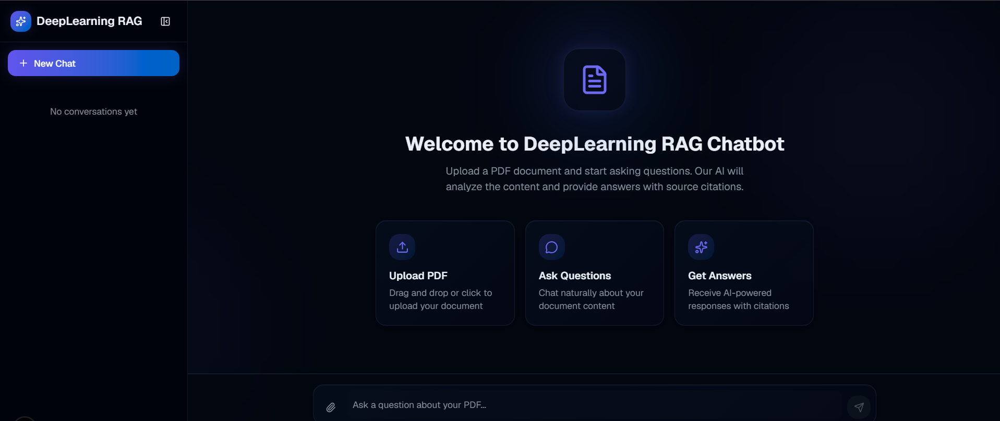
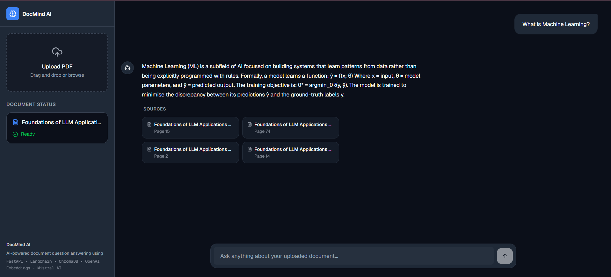
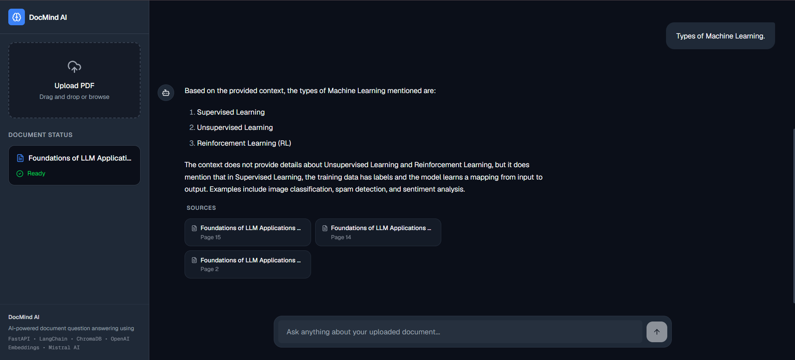

# DocMind AI

Document and web-page question answering with FastAPI, LangChain, ChromaDB,
OpenAI embeddings and chat, and a Next.js frontend.

Upload a text-based PDF or Markdown file, or submit a website URL. DocMind
splits the extracted text into chunks, combines keyword and semantic retrieval,
and passes retrieved passages to a chat model with source metadata.

## Live Demo

[Open DocMind AI](https://doc-mind-ai-green.vercel.app/)

This README describes the code in this branch. The public demo may run an
earlier release until these changes are merged and deployed.

## Features

- PDF, Markdown (`.md`, `.markdown`), and HTTP/HTTPS web-page ingestion.
- A shared processing pipeline for file and website documents.
- Token-based recursive chunking: 700-token maximum and 100-token target overlap,
  using the tokenizer for `text-embedding-3-small`.
- Chroma semantic retrieval with Maximal Marginal Relevance (MMR).
- BM25 keyword retrieval over the same document chunks.
- Weighted Reciprocal Rank Fusion (RRF) through `EnsembleRetriever`, with equal
  BM25 and Chroma weights.
- Filename and page citations for PDFs, filenames for Markdown, and clickable
  full source URLs for websites. Missing page labels are returned as `null`.
- A Next.js interface with file/website inputs and processing states.
- A backend Docker image and GitHub Actions build workflow.

Retrieval comparisons and automated quality evaluation are still planned.
Implemented hybrid search does not establish measured accuracy gains, and the
context-only prompt does not guarantee that answers are supported by sources.

## How It Works

```text
PDF / Markdown file                  Website URL
        |                                 |
PyPDFLoader / TextLoader              WebBaseLoader
        |                                 |
        +------------ Documents ----------+
                          |
                 Token-based chunking
                          |
                 +--------+--------+
                 |                 |
        OpenAI embeddings       BM25 index
        Chroma collection       (in memory)
                 |                 |
        Semantic/MMR results   Keyword results
                 |                 |
                 +--- Weighted RRF-+
                          |
              Retrieved context + question
                          |
                   OpenAI chat model
                          |
                 Answer + source list
```

Chroma stores chunk text, metadata, and embeddings in `chroma_db`. The active
BM25 retriever is held in FastAPI app state. Each new ingestion replaces the
shared active corpus; there is no separate collection for each visitor.

## Tech Stack

| Area | Tools |
| --- | --- |
| Backend | Python, FastAPI, Pydantic, LangChain |
| Retrieval | ChromaDB, OpenAI embeddings, BM25, MMR, weighted RRF |
| Ingestion | PyPDFLoader, TextLoader, WebBaseLoader, tiktoken |
| Answer generation | OpenAI through ChatOpenAI; model configured in backend/rag.py |
| Frontend | Next.js, React, TypeScript, Tailwind CSS, UI components, Lucide |
| Build and deployment | Docker, GitHub Actions; frontend/backend hosted separately |

## Project Structure

```text
.github/workflows/python-app-ci.yml   Backend CI
backend/
  api.py                             Upload, URL ingestion, and chat endpoints
  ingestion.py                       Loading, chunking, and index creation
  rag.py                             Hybrid retrieval, prompting, and citations
  requirements.txt                   Pinned direct dependencies
  Dockerfile
  .dockerignore
frontend/
  app/                               Next.js pages and layout
  components/chat/                   Source inputs, chat, and citation display
  lib/api.ts                         API URL, shared types, and validation helpers
sample_documents/                    Example PDF
screenshots/                         Existing interface screenshots
```

## Local Setup

### Clone

```bash
git clone https://github.com/Rishabh150102/DeepLearning-RAG-Chatbot.git DocMind-AI
cd DocMind-AI
```

### Backend

Python 3.11 is used by Docker and CI. From the repository root:

```bash
python -m venv .venv
```

Activate on Windows PowerShell:

```powershell
.\.venv\Scripts\Activate.ps1
```

Or on macOS/Linux:

```bash
source .venv/bin/activate
```

Install dependencies:

```bash
python -m pip install -r backend/requirements.txt
```

Create the local, ignored `backend/.env` with your own key:

```dotenv
OPENAI_API_KEY=YOUR_OPENAI_API_KEY
USER_AGENT=DocMindAI/1.0
```

Keep values unquoted so this file also works with Docker's `--env-file`.
Do not commit API keys. Mistral credentials are not required by the current code.

Run from `backend/` so relative imports and storage paths resolve consistently:

```bash
cd backend
python -m uvicorn api:app --reload --host 127.0.0.1 --port 8001
```

Open [FastAPI interactive docs](http://127.0.0.1:8001/docs).

### Frontend

In a separate terminal, from the repository root:

```bash
cd frontend
npm ci
```

Create the ignored `frontend/.env.local`:

```dotenv
NEXT_PUBLIC_API_URL=http://127.0.0.1:8001
```

```bash
npm run dev
```

Open the URL printed by Next.js. Restart it after changing its environment
configuration. Never place the OpenAI key in a `NEXT_PUBLIC_` variable.

## Run the Backend with Docker

From the repository root:

```bash
docker build -t docmind-backend:test ./backend
docker run --rm --env-file backend/.env -e USER_AGENT=DocMindAI/1.0 -p 8002:8000 docmind-backend:test
```

Open [container API docs](http://127.0.0.1:8002/docs). To connect the local frontend,
set `NEXT_PUBLIC_API_URL=http://127.0.0.1:8002` and restart Next.js.

The image contains the backend only. Uvicorn listens on container port 8000;
the command publishes it on host port 8002. Environment variables are supplied
at runtime. `.dockerignore` excludes `.env`, uploads, Chroma data, and Python caches.

Recreate the container after editing `backend/.env`; restarting an existing
container does not reload `--env-file`. Rebuild after source or dependency changes.

There is no persistent volume in this command. Removing the container discards
its Chroma data; restarting the backend loses its in-memory BM25 index.
Ingest a source again before chatting after a restart. The frontend runs separately.

## API

| Endpoint | Request | Purpose |
| --- | --- | --- |
| `POST /upload` | Multipart form data with field `file` | Index a PDF or UTF-8 Markdown file |
| `POST /url` | JSON containing `url` | Fetch and index one HTTP/HTTPS page |
| `POST /chat` | JSON containing `question` | Retrieve passages and generate an answer |

URL request:

```json
{"url": "https://quotes.toscrape.com/"}
```

Chat request:

```json
{"question": "Which authors are quoted on this page?"}
```

Example website chat response shape:

```json
{
  "answer": "...",
  "sources": [
    {"page": null, "source": "https://quotes.toscrape.com/"}
  ]
}
```

PDF page labels can be strings; Markdown and websites normally have no page label.
Chat before a BM25 retriever is available returns HTTP 409. Pydantic validates
URL syntax, not whether the page is accessible.

## GitHub Actions CI

`.github/workflows/python-app-ci.yml` runs on pushes to `main` and pull requests
targeting `main`. On Ubuntu, it:

1. Checks out the repository and sets up Python 3.11.
2. Installs `backend/requirements.txt`.
3. Checks Python syntax with `python -m compileall backend`.
4. Builds the image with `docker build --tag docmind-backend:ci ./backend`.

The workflow does not yet run unit tests, a linter, frontend checks, container
startup checks, or RAG quality evaluations. It does not publish the image or
deploy the app. A green build does not verify retrieval or answer quality.
Direct dependencies are pinned; a complete transitive dependency lock is not provided.

## Try It

- Upload `sample_documents/Foundations_of_Generative_AI_and_RAG.pdf` and ask
  "What is retrieval-augmented generation?"
- Upload a UTF-8 Markdown file and ask about a fact explicitly stated in it.
- Ingest `https://quotes.toscrape.com/` and ask which authors appear on that page.
- Ingest a page from `https://books.toscrape.com/` and ask about visible titles
  or prices. Star ratings represented by CSS classes may be missing from the text.

Ingestion uses OpenAI embeddings and consumes API credits. Re-ingesting the same
source creates embeddings again. The backend container has been manually checked
for startup, ingestion, and a chat response. Systematic retrieval comparisons
and automated end-to-end testing remain pending.

## Known Limitations and Release Follow-ups

- **Shared state:** one active corpus serves the entire backend, without user/session
  isolation, authentication, or persistent chat history. In-memory BM25 is intended
  for one application process, not independent worker processes.
- **Restarts:** BM25 must be rebuilt after backend restart. Chroma needs a persistent
  disk or volume to survive container replacement.
- **Web extraction:** only the supplied page is fetched. There is no link crawling,
  pagination, JavaScript rendering, or automatic refresh during chat. Login and bot
  protection can prevent extraction. Non-text content, such as ratings stored in
  HTML attributes, may be unavailable.
- **Web failures:** access-denied pages can currently be indexed and reported as
  successful ingestion. Explicit handling for blocked requests, fetch failures,
  and empty content is pending. URL syntax validation does not restrict access
  to private networks; target restrictions are needed before accepting untrusted
  public URL submissions.
- **Upload handling:** unsupported files raise an uncaught `ValueError` rather than
  HTTP 415, and files are saved before extension validation. The shared processor
  deletes all files in `uploads/` before indexing. Cleanup should instead delete
  only the current temporary upload using `finally`.
- **Index replacement:** updates are not transactional; failed ingestion can leave
  an incomplete collection or chat unavailable.
- **Citations:** these list retrieved sources, not verified evidence for individual
  claims or numbered paragraphs. Set-based deduplication does not preserve order.
  The prompt cannot guarantee freedom from hallucinations.
- **PDFs:** scanned PDFs need OCR, which is not implemented.
- **Evaluation:** hybrid retrieval is implemented, but no measured accuracy gain has
  been established. Comparing BM25, semantic/MMR, and fused results is still pending.

## Next Improvement Cycle

- Reranking, passage/paragraph metadata, and citation enforcement.
- Ragas evaluation and measured quality thresholds in CI.
- Persistent retrieval state and per-user document isolation.
- Non-root container execution, startup checks in CI, image publishing, and CD.

## Screenshots

Existing screenshots may predate Markdown and website inputs.





## Author

**Rishabh Rajput**


